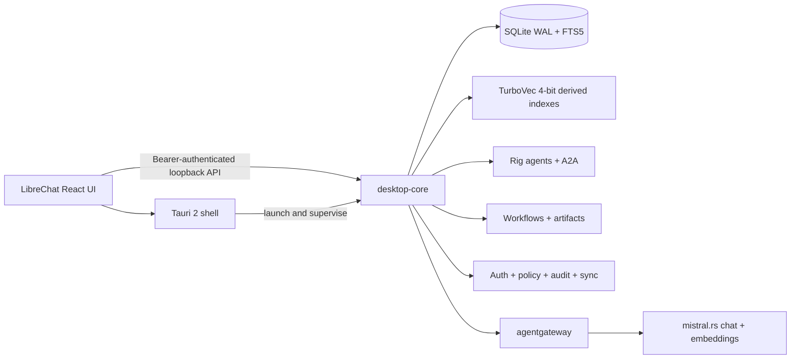

# NorthBridge desktop runtime

NorthBridge keeps the LibreChat React client as its product UI while moving desktop-only runtime ownership into Rust. The production desktop target does not treat the legacy Express and MongoDB services as permanent dependencies.

The implementation is intentionally split into independently testable processes:



## Implemented desktop runtime

The first runtime slice provides:

- An out-of-process `desktop-core` binary that binds only to loopback, defaults to an ephemeral port, and emits a machine-readable ready event.
- A per-launch bearer-token boundary for every local API route.
- Explicit WebView origin allowlisting and bounded JSON bodies.
- An authoritative SQLite database configured for WAL, foreign keys, busy handling, and embedded migrations.
- Immutable conversation branches with optimistic branch-head conflict detection.
- Structured message parts and FTS5-backed local conversation search.
- Persistent generation runs and append-only, monotonically sequenced generation events.
- SSE replay using either `after` or `Last-Event-ID`, followed by live delivery.
- A Tauri 2 shell that owns the core process, generates a per-launch token, validates the ready envelope, and exposes only redacted bootstrap state to the WebView.
- A typed desktop transport package that performs authenticated fetch and resumable SSE without placing credentials in URLs.
- An integrity-checked agentgateway boundary and supervised mistral.rs runtimes for chat and embeddings; ordinary storage and filesystem work never crosses the AI gateway.
- Durable managed-model downloads/imports, hardware qualification, explicit load profiles, quantization controls, and performance telemetry.
- Persisted two-to-four-way split chats with independent branches, streams, and cancellation.
- Content-addressed document originals, durable ingestion jobs, structured extraction, and source-aware chunking.
- SQLite-authoritative FTS5 and embeddings with rebuildable TurboVec 4-bit snapshots, a mutation journal, manifest validation, and crash/restart recovery.
- Knowledge Stacks with folder/Obsidian watchers, hybrid retrieval, citations, chunk inspection, and per-generation grounding provenance.
- Rig-owned Personas, Skills, agents, approvals, Crews, Shadow Persona, MCP, and official A2A client/server surfaces.
- Typed durable workflows with human approval, bounded loops, parallel branches, restricted transforms, and conservative crash recovery.
- Content-addressed Forge artifacts, gateway-routed image/audio/video jobs, OS-vault credentials, environments, and secretless package exchange.
- An opt-in headless server mode with remote authentication, team policy, hash-chain audit records, and optimistic idempotent sync.

Run the verified Rust surface from the repository root:

```powershell
$env:NORTHBRIDGE_SESSION_TOKEN = '<at-least-32-byte-random-token>'
npm run desktop:core -- --database .\data\northbridge.sqlite
```

The first line on standard output is a ready envelope:

```json
{"event":"ready","address":"http://127.0.0.1:49152","pid":1234,"schemaVersion":11}
```

Logs are written to standard error so the Tauri supervisor can parse standard output without exposing the session token.

## Ownership map

| Surface | Owner | Authority |
|---|---|---|
| Product interface | `client/` and existing LibreChat packages | React UI and upstream-compatible presentation |
| Native lifecycle | `apps/desktop/src-tauri/` | Window, tray, updater, capabilities, sidecar supervision |
| Local HTTP/SSE contract | `crates/core-api/` | Authentication, request limits, DTO transport, streaming |
| Product domain | `crates/domain/` | Stable Rust entities shared across runtime crates |
| Durable local data | `crates/storage/` and `migrations/` | SQLite source of truth and FTS5 lexical index |
| Runtime composition | `crates/desktop-core/` | Process startup, health, diagnostics, graceful shutdown |
| AI protocol traffic | `agentgateway` sidecar | The only LLM, embedding, MCP, and A2A route |
| Local inference | `mistral.rs` sidecar | Inference and model-native structured generation |
| Dense retrieval | `crates/retrieval/` plus TurboVec | Rebuildable acceleration derived from SQLite |
| Document ingestion | `crates/ingestion/` | Files, parsing, blobs, chunking, jobs, and watchers |
| Agents and protocols | `crates/agent-runtime/` | Rig loops, MCP, official A2A, tool policy, and durable agent execution |
| Workflows and platform | `crates/core-api/` and `crates/storage/` | Turnstiles, approvals, artifacts, media, environments, packages, auth, policy, audit, and sync |

See [implementation-status.md](implementation-status.md) for the live boundary.

## Security invariants

- `desktop-core` defaults to loopback and refuses non-loopback binding unless server mode, explicit origins, and TLS termination are all asserted.
- The session token is provided through `NORTHBRIDGE_SESSION_TOKEN`, never a command-line argument or ready event.
- All API endpoints except remote login require either the local session token or a valid hashed remote session.
- Only explicit Tauri/WebView origins receive cross-origin response headers.
- SQLite and ordinary desktop operations never pass through agentgateway.
- All chat and embedding traffic does pass through agentgateway; `desktop-core` never calls mistral.rs directly.
- MCP, A2A, and media-provider traffic also passes through agentgateway; upstream authorization headers are reconstructed from OS-vault-backed environment values.
- Secret values never enter SQLite, package exports, generated gateway YAML, or API responses.
- Dense snapshots are disposable. SQLite documents, chunks, embeddings, and the dense journal are authoritative.
- Workflow transforms execute in a restricted deterministic worker with no shell, filesystem, or network access. External Tool and A2A attempts interrupted at the crash boundary become `unknown_outcome` instead of being replayed.

## API foundation

All paths are under `/v1`:

| Method | Path | Purpose |
|---|---|---|
| `GET` | `/health` | Database and schema readiness |
| `GET`, `POST` | `/conversations` | Cursor-paginated list and creation |
| `GET`, `DELETE` | `/conversations/{id}` | Read and soft-delete |
| `GET`, `POST` | `/conversations/{id}/messages` | Read a branch and append at its current head |
| `POST` | `/conversations/{id}/generations` | Reserve a persistent generation run |
| `GET` | `/generations/{id}` | Read generation state |
| `GET` | `/generations/{id}/events` | Replay and stream sequenced SSE events |
| `GET` | `/search/messages` | FTS5 lexical message search |
| `GET`, `POST` | `/models/*` | Catalog, managed models, selection, downloads, imports, and tuning |
| `GET`, `POST` | `/conversations/{id}/split-chats` | Persisted multi-model comparison runs |
| `GET`, `POST` | `/knowledge/stacks` | List and create Knowledge Stacks |
| `GET`, `POST` | `/knowledge/stacks/{id}/documents*` | List and ingest stack documents |
| `POST` | `/knowledge/stacks/{id}/search` | Workspace-filtered hybrid retrieval with citations |
| `GET`, `POST` | `/knowledge/stacks/{id}/watch-roots` | Folder and Obsidian watcher management |
| `GET`, `POST` | `/knowledge/stacks/{id}/index` | Validate or rebuild the derived dense index |
| `GET`, `POST` | `/agents`, `/personas`, `/skills`, `/agent-runs` | Persistent agent definitions, execution, and approvals |
| `GET`, `POST` | `/mcp/servers`, `/remote-agents`, `/crews`, `/shadow-personas` | MCP, A2A, Crew, and Shadow Persona operations |
| `GET`, `POST` | `/workflows`, `/workflow-runs`, `/workflow-approvals` | Durable Turnstile definitions and controls |
| `GET`, `POST` | `/artifacts`, `/credentials`, `/environments`, `/media/*` | Forge artifacts, OS-vault references, environments, and media jobs |
| `POST` | `/packages/export`, `/packages/import` | Validated portable package exchange without secrets |
| `POST` | `/auth/login`; `/team/*`, `/audit/*`, `/sync/*` | Remote sessions, team policy, hash-chain audit, and synchronization |
